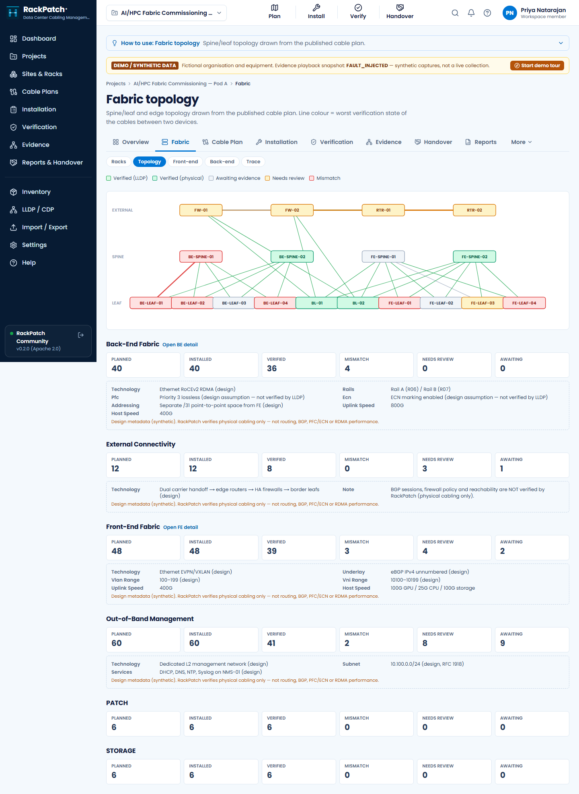
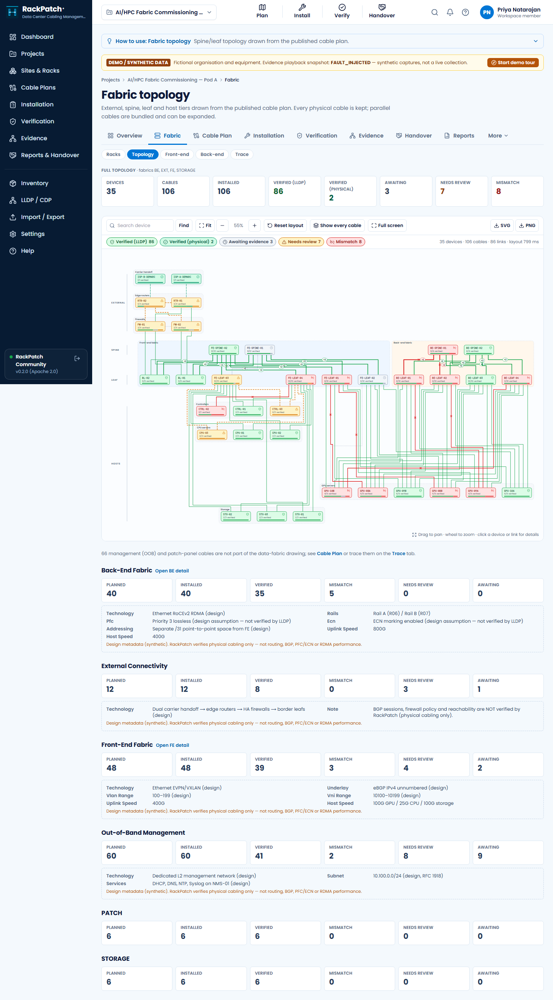
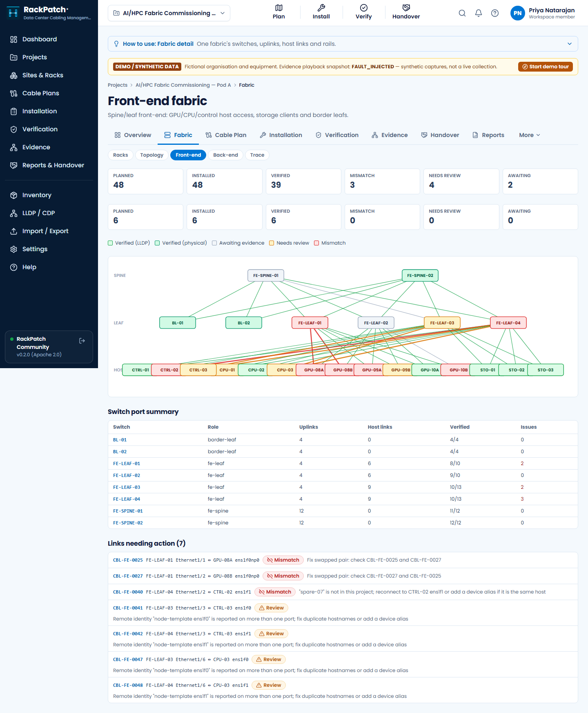
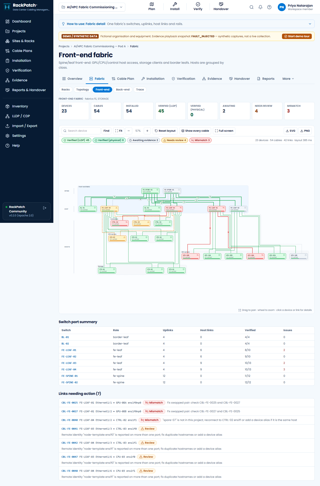
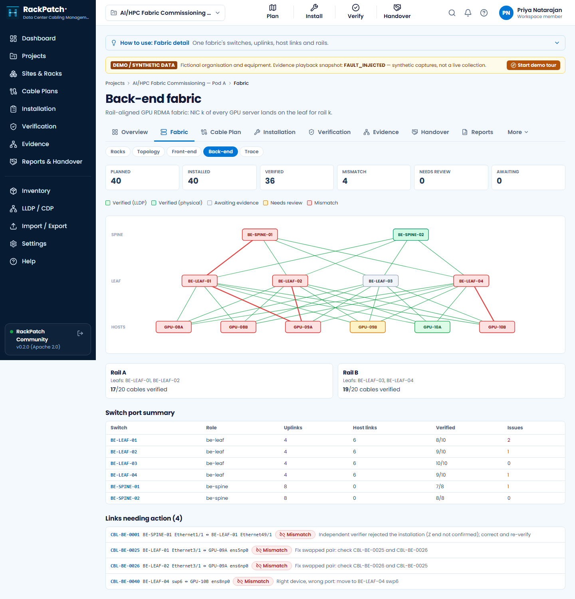
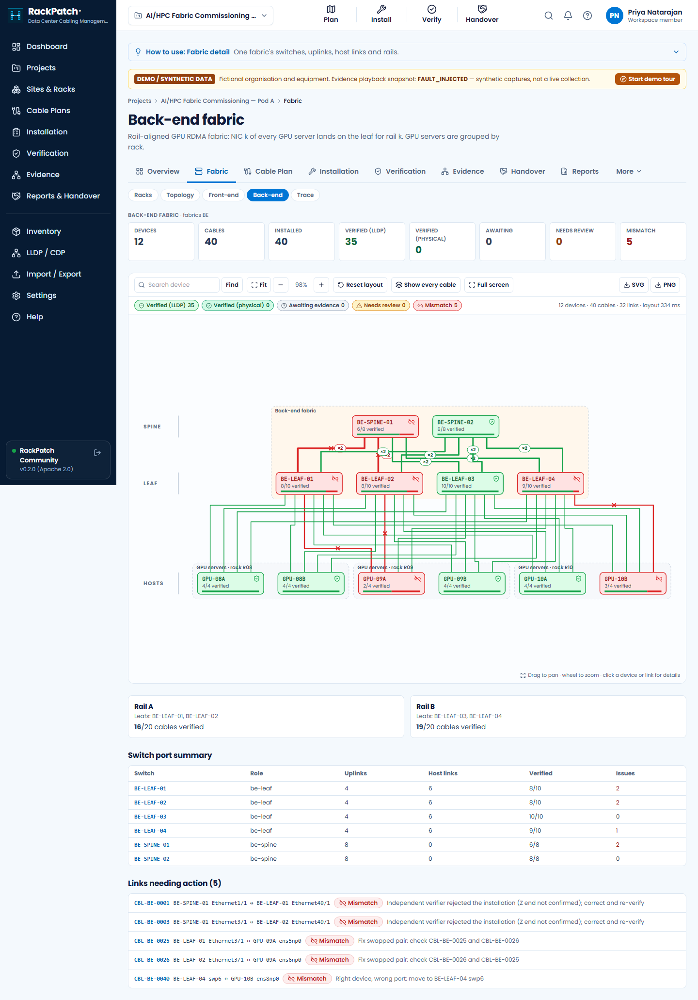
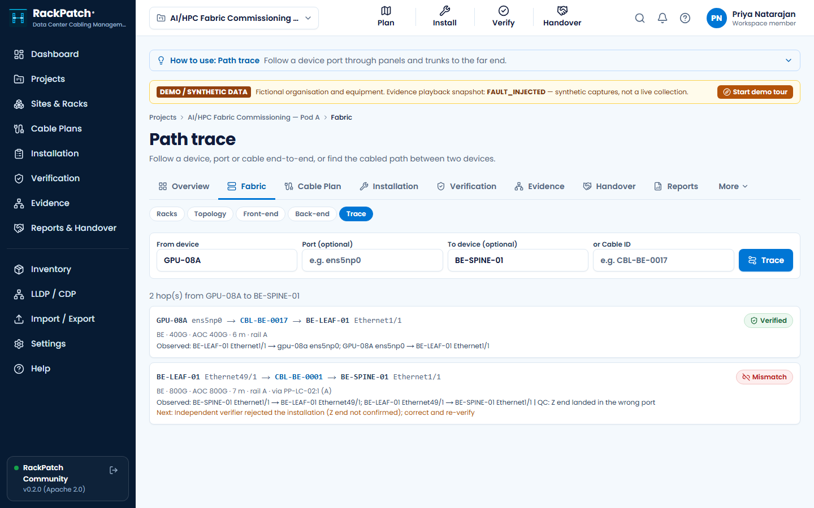
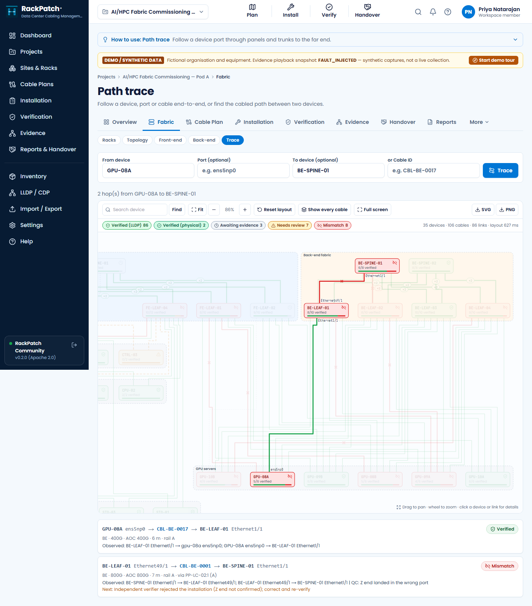

# Topology redesign: SIT report

Date: 2026-11-22. Environment: local SIT server (production build, `next start` on :3100, `HOSTED_SAAS=true`) with the isolated `rackpatch_sit` database, Chromium (Playwright), Windows 11. Not deployed.

All numbers below come from test runs on this date. Raw outputs: `docs/qa/raw/topology-before.json`, `topology-after.json`, `topology-sit.json`, `topology-scale-node.json`.

## What changed

- The Topology (Full), Front-end, Back-end and Trace views now use one shared viewer (`src/components/topology/`) with a deterministic ELK layered layout (`elkjs`, orthogonal routing, fixed seed, one row per tier: External, Spine, Leaf, Hosts).
- Cables between the same two devices are drawn as one bundle with a `×n` badge; every cable stays individually selectable and listed with its own record. Nothing is removed or merged across device pairs; an integrity check (`checkGraphIntegrity`) validates this in tests.
- Device status is the worst state over all of its cables, with a per-status bar and an `x/y verified` count (never derived from a single interface).
- Panels: device (role, rack/U, hardware, management IP or "Not recorded", connected devices, every interface with cable ID, type, speed, planned vs discovered, LLDP/CDP evidence, physical verification, mismatch explanation), link (all cable records of the bundle), host group.
- Tools: search, fit, zoom in/out, reset layout, show every cable, full screen, SVG and PNG export, clickable status legend with counts that filters cables.
- One stats strip above each diagram (the duplicate per-fabric rows on the Front-end/Back-end pages were removed). The per-fabric design sections, rails, switch port table and "Links needing action" are unchanged.
- Trace: the diagram opens framed on the traced path, with interface labels on the path; the hop list is unchanged.
- Performance: layout runs in a Web Worker (page fallback only if the worker fails), cached per topology structure in memory and `localStorage` (status changes never invalidate it), progressive drawing, off-screen culling above 250 devices, labels hidden below 30 % zoom. Views above 40 devices start with same-class hosts of a rack collapsed into one expandable group node.
- Data loading (`loadFabric`) only gained extra read-only fields (cable type, expected summary, evidence source, capture time, observed sides, latest physical check). No API, permission, auth or database changes.

## Before and after

| View | Before | After |
|---|---|---|
| Full |  |  |
| Front-end |  |  |
| Back-end |  |  |
| Trace |  (no diagram) |  |

Geometry measured on the rendered SVG (same measurement script for both):

| View | Devices before / after | Overlapping devices before / after | Cable segments through a device before / after | Crossings before / after (bundled) |
|---|---|---|---|---|
| Full | 18 / 35 (hosts were not drawn before) | 9 / 0 | 6 / 0 | 34 / 272 (not comparable: hosts added) |
| Front-end | 23 / 23 | 14 / 0 | 18 / 0 | 210 / 47 |
| Back-end | 12 / 12 | 0 / 0 | 0 / 0 | 96 / 104 |

With every cable drawn individually: Full 0 overlaps, 0 through devices, 339 crossings; Front-end 0, 0, 92; Back-end 0, 0, 122. Label overflow: 0 everywhere.

## SIT results (e2e/sit/topology.spec.ts): 3 of 3 passed

Run twice; the second run (after the final build) passed 4 of 4 including the screenshot spec. Expected values are queried from `rackpatch_sit` with Prisma, not taken from the UI.

| # | Check | Result | Evidence |
|---|---|---|---|
| 1 | Every topology tab works | Pass | Topology, Front-end, Back-end, Trace reached through the sub-navigation; diagram ready on each |
| 2 | All devices and cables represented | Pass | Drawn device set and cable set equal the database exactly: Full 35/106, Front-end 23/54, Back-end 12/40; no duplicates |
| 3 | No devices overlap | Pass | 0 in all views, bundled and expanded |
| 4 | No links through device boxes | Pass | 0 in all views, bundled and expanded |
| 5 | Crossings minimised | Pass (Front-end), see defects (Back-end) | Front-end 210 → 47; Back-end 96 → 104 |
| 6 | Bundles expand correctly | Pass | Expanding a bundle shows exactly the database cables between that device pair |
| 7 | LLDP/CDP statuses accurate | Pass | Every drawn cable's status equals its finding state in the database (0 mismatches across 200 cable checks) |
| 8 | Mismatch and review filters | Pass | Lit cables equal the database set: Full 8 mismatch / 7 review, Front-end 3 / 4, Back-end 5 / 0 |
| 9 | Device and link details correct | Pass | Device panel lists exactly that device's cables in the view; link panel lists exactly the bundle's cables |
| 10 | Zoom, pan, search, reset, export | Pass | Zoom level changes; pan moves the view; search opens BE-LEAF-03; reset gives identical positions; SVG 35,838 bytes and PNG 158,806 bytes downloaded |
| 11 | Refresh keeps positions | Pass | Identical positions after reload (cached) and in a new browser with no cache (recomputed), all three views |
| 12 | Large topology responsive | Pass | See performance below |
| 13 | Existing workflows unaffected | Pass | See regression |
| 14 | No console errors or failed API calls | Pass | 0 console errors, 0 failed requests across all topology pages |
| — | Visual regression | Pass | Baselines `e2e/sit/topology.spec.ts-snapshots/topology-{full,fe,be}-chromium-win32.png`; second run matched within 1 % |

## Performance

Generated spine/leaf plans (`tests/fixtures/topology-scale.ts`), imported into `rackpatch_sit` through the real CSV import and publish path for the browser test, then removed.

Browser (production build, Web Worker layout):

| Devices | Cables | Shown initially | Ready (navigation to drawn) | Layout | Expand all hosts | Slowest main-thread ping while expanding |
|---|---|---|---|---|---|---|
| 20 | 44 | 20 | 1.08 s | 459 ms | not needed | — |
| 50 | 108 | 15 (5 host groups) | 0.96 s | 235 ms | 0.40 s | 10 ms |
| 100 | 212 | 22 (8 host groups) | 1.00 s | 266 ms | 0.99 s | 9 ms |
| 500 | 1,432 | 69 (27 host groups) | 1.34 s | 759 ms | 25.2 s | 170 ms |

All initial and expanded views: 0 overlapping devices, 0 cable segments through a device (for 500 expanded, measured on the on-screen part; the full drawing is measured in Node below).

Node (vitest, same layout code): 500 devices fully expanded lay out in 30.4 s with 0 overlaps and 0 segments through devices; grouped view 0.4 s. Layouts are identical on repeated runs at every size.

## Regression

| Suite | Result |
|---|---|
| Unit tests (`vitest run`) | 39 files, 294 tests passed (includes 20 new topology tests) |
| Typecheck (`tsc --noEmit`) | Pass |
| Lint (`next lint`) | No warnings or errors |
| Production build | Pass |
| SIT workflows (A–G including AI/HPC fabrics and trace), controls, fonts, resilience, perf | All passed |
| SIT crawl: every route as lead, axe serious/critical | Passed after one fix (legend count contrast 4.16:1 → full colour) |
| SIT security + crawl cross-workspace | First run: 3 failures from the shared demo (below). After retargeting to a private project: 4 of 4 passed; the outside user was denied on all 35 private-project pages, with positive member controls passing |

## Remaining defects and limits

1. **Resolved: 3 SIT access tests assumed the AI/HPC demo was private.** The shared read-only demo (commit e18c536) gives every signed-in user a VIEWER membership on it (`lead@demo.rackpatch.local` received it on 2026-11-22). As agreed, the cross-workspace read checks now target the private "SIT Scale 5000" project, with positive controls for the member; the write-replay test still runs against the demo and confirms viewers and other workspaces cannot change it.
2. **Back-end crossings 104 vs 96 before.** The Back-end is a complete spine/leaf mesh plus rail cabling; orthogonal routes have more segments than the old straight lines, so the segment-pair count is not strictly lower. No overlaps or cables through devices, which the old view also had none of here.
3. **Full view at 1440 px fits at about 53 % zoom.** Labels are readable but small; full screen or zoom is better for detail.
4. **500 devices fully expanded takes about 25 s to lay out** (in the worker; the page stays usable). The default grouped view is ready in 1.3 s.
5. The long-task observer reported 0 ms in every run; responsiveness is evidenced by the ping timings instead.
6. Visual baselines are platform-specific (Chromium on Windows).
7. In the first full run the zoom result was logged after reset (shown as 98 % → 98 %); the zoom assertion itself passed. The logging is fixed for future runs.
